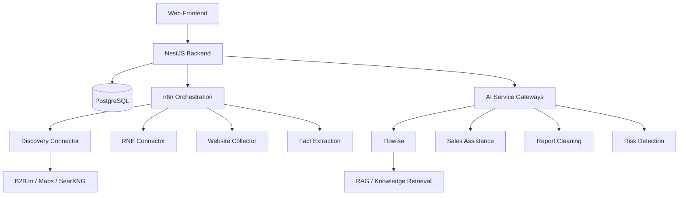

# DME B2B — AI Integration Guide

## 1. Overview

This guide describes how to deploy and integrate the AI components of the DME B2B Prospecting Platform into the existing web application.

The AI system provides:

- Automated campaign planning and research.
- Multi-source company discovery.
- Candidate normalization and deduplication.
- Company registry verification.
- Website enrichment and fact extraction.
- Intelligent prospect scoring.
- Personalized B2B offer recommendations.
- AI-powered sales assistance.
- Sales report cleaning and structuring.
- Risk detection.

The AI components are implemented as independent services and workflows that communicate through APIs.

## 2. System architecture

The web application communicates with the NestJS backend, which acts as the integration layer between the application and the AI services.



This diagram represents the logical architecture. The exact service dependencies and network configuration are defined in the Docker Compose files and application configuration.

**Integration principle:** the frontend should communicate with the NestJS backend rather than directly accessing n8n, Flowise or internal AI microservices.

## 3. Repository structure

```text
B2B/
├── applications/
│   ├── dme_backend-main/
│   │   ├── src/ai/
│   │   ├── src/prospecting/
│   │   └── .env.example
│   └── dme_frontend-main/
│       ├── lib/api.ts
│       ├── app/prospection/
│       ├── components/meetings/
│       └── .env.example
├── services/
│   ├── discovery-connector/
│   ├── rne-connector/
│   ├── website-collector/
│   ├── fact-extraction-gateway/
│   ├── dme-assistant-gateway/
│   ├── report-cleaner-gateway/
│   └── risk-detector-gateway/
├── deployment/
│   ├── application/
│   │   └── docker-compose.yml
│   └── Individual service deployments
├── n8n/
├── flowise/
├── scripts/
│   ├── start-application-local.sh
│   └── stop-application-local.sh
└── README_AI_INTEGRATION.md
```

| Directory | Responsibility |
|---|---|
| applications/ | Web application and backend integration |
| services/ | AI microservice implementations |
| deployment/ | Docker deployment configurations |
| n8n/ | Importable automation workflows |
| flowise/ | Importable Chatflows and Agentflows |
| scripts/ | Local startup and shutdown |

## 4. Prerequisites

Install the following tools before starting:

- Git
- Docker
- Docker Compose v2
- Bash or WSL for Windows users
- Node.js and npm if running the application outside Docker

Verify your installation:

```bash
git --version
docker --version
docker compose version
```

## 5. Clone the integration branch

```bash
git clone -b application-ai-integration <REPOSITORY_URL>
cd B2B
```

If the repository is already cloned:

```bash
git fetch origin
git switch application-ai-integration
git pull --ff-only origin application-ai-integration
```

Avoid overwriting uncommitted local changes when switching branches.

## 6. Environment configuration

Create the application's local environment files from the provided templates.

```bash
cp -n applications/dme_backend-main/.env.example \
      applications/dme_backend-main/.env

cp -n applications/dme_frontend-main/.env.example \
      applications/dme_frontend-main/.env
```

Locate additional service configuration templates:

```bash
find deployment services -name ".env.example"
```

Configure the environment variables described in each template and service deployment guide.

Depending on the enabled features, configuration may include:

- Database connection settings.
- Backend URL and authentication configuration.
- n8n webhook URLs.
- Flowise API URLs and workflow identifiers.
- LLM provider credentials.
- Google Maps API credentials.
- RNE API credentials.
- SearXNG configuration.
- Internal microservice URLs.

Use the variable names defined in the provided configuration files.

Never commit populated `.env` files or expose private API credentials in frontend code.

RNE verification requires valid official API credentials. Without these credentials, the system returns a review-required result instead of claiming that a company has been verified.

## 7. Docker deployment

The project provides Docker Compose configurations and scripts for local application deployment.

### 7.1 Inspect the deployment

From the repository root:

```bash
docker compose \
  -f deployment/application/docker-compose.yml \
  config --services
```

This command lists the services included in the application Compose configuration.

Additional service-specific Docker configurations are available under `deployment/`.

### 7.2 Start the application

Review the provided startup script and its requirements:

```bash
cat scripts/start-application-local.sh
```

Once the environment variables and required dependencies are configured, execute:

```bash
bash scripts/start-application-local.sh
```

For manual deployment of the application Compose stack:

```bash
docker compose \
  -f deployment/application/docker-compose.yml \
  up -d
```

Do not run both startup methods unnecessarily. Follow the startup script's documented behavior.

If an AI service is not included in the application stack or startup script, start it using its corresponding deployment guide.

### 7.3 Check service status

```bash
docker ps
```

```bash
docker compose \
  -f deployment/application/docker-compose.yml \
  ps
```

### 7.4 View logs

```bash
docker logs --tail 100 <CONTAINER_NAME>
```

To follow logs:

```bash
docker logs -f <CONTAINER_NAME>
```

### 7.5 Stop the application

```bash
bash scripts/stop-application-local.sh
```

Do not delete Docker volumes unless a complete data reset is intended.

## 8. Service directory and ports

The following ports correspond to the previously documented local development configuration. Verify them against the current Compose files.

| Service | Default local port |
|---|---:|
| NestJS Backend | 3001 |
| Flowise | 3000 |
| n8n | 5678 |
| PostgreSQL | 55432 |
| Discovery Connector | 8080 |
| RNE Connector | 8081 |
| Fact Extraction Gateway | 8083 |
| Website Collector | 8084 |
| DME Assistant Gateway | 8085 |
| Report Cleaner Gateway | 8086 |
| Risk Detector Gateway | 8087 |
| SearXNG | 8088 |

Internal Docker communication should use the configured service names and container ports.

Inside a Docker container, `localhost` refers to that container itself, not another service.

## 9. n8n workflow setup

Open the n8n interface:

```text
http://localhost:5678
```

The exported workflow definitions are available in the `n8n/` directory.

If workflows are not automatically provisioned by the deployment scripts:

1. Open n8n.
2. Import the required workflow JSON files.
3. Configure credentials and environment-dependent URLs.
4. Reconnect references to imported sub-workflows where necessary.
5. Activate workflows that require production webhook access.
6. Verify that the backend uses the correct webhook URLs.

The workflow set includes:

- Research Planner and Query Composer.
- Discovery Executor.
- Candidate Normalization and Deduplication.
- RNE Validation.
- Website Enrichment and Fact Extraction.
- Company Scoring.
- Offer Recommendations.
- Sales Assistant.
- Report Cleaner.
- Risk Detector.
- Full Campaign Orchestrator.

Import existing workflows rather than recreating their logic manually.

## 10. Flowise setup

Open Flowise:

```text
http://localhost:3000
```

The exported flows are organized as follows:

```text
flowise/
├── Chatflow exports
├── all-in-one/
└── agentflows/
```

If the required flows are not automatically provisioned:

1. Import the appropriate Chatflow or Agentflow.
2. Configure the credentials used by the flow.
3. Configure the required language and embedding models.
4. Configure knowledge retrieval components where required.
5. Verify connection URLs for external services.
6. Save the flow.
7. Configure the generated flow identifier in the corresponding backend or gateway settings.
8. Test the flow before connecting it to the application.

Flowise-only implementations are also provided for selected workflows. In particular, the separately tested Flowise Discovery Executor retrieves B2B.tn data directly without calling n8n.

The standalone Flowise architecture should not be confused with the existing web integration path.

## 11. Main AI features

### 11.1 Intelligent prospecting

The prospecting pipeline transforms campaign criteria into enriched and scored company candidates.

```text
Campaign criteria
       ↓
Research Planner
       ↓
Discovery Executor
       ↓
Normalization and Deduplication
       ↓
Registry Validation
       ↓
Website Enrichment
       ↓
Fact Extraction
       ↓
Company Scoring
       ↓
Offer Recommendations
       ↓
Prospecting Results
```

The frontend submits prospecting requests through the backend and displays returned results according to the API contract.

### 11.2 Company dossier

The company research pipeline combines discovered company data, registry information when available, website information, extracted facts and AI analysis.

The frontend should display available evidence and distinguish verified information from incomplete or review-required information.

### 11.3 DME Sales Assistant

The sales assistant provides contextual AI assistance for sales activities and B2B offer recommendations.

The application communicates with the dedicated assistant integration through the backend.

### 11.4 Report Cleaner

Processes unstructured sales or meeting reports into cleaner, more usable information.

The cleaned result should remain editable by the user before being finalized.

### 11.5 Risk Detector

Analyzes relevant information and identifies potential risk signals.

Risk outputs are decision-support information and should not be treated as definitive conclusions without validation.

## 12. Backend API integration

The NestJS backend is the primary integration point.

Default local backend URL:

```text
http://localhost:3001
```

Swagger / OpenAPI documentation:

```text
http://localhost:3001/api/docs
```

Use Swagger to inspect HTTP methods, required fields, authentication, response schemas and available operations.

Previously documented application routes include:

| Route | Purpose |
|---|---|
| `/login` | Authentication |
| `/refresh` | Token refresh |
| `/prospecting` | Prospecting operations |
| `/prospecting/history` | Prospecting history |
| `/prospecting/runs/:runId` | Prospecting run information |
| `/prospecting/:companyId/dossier` | Company dossier |
| `/prospecting/:companyId/report` | Company report |

Confirm the current methods, prefixes and parameters in Swagger and the NestJS controllers before integrating.

Backend integration source files:

```text
applications/dme_backend-main/src/ai/
applications/dme_backend-main/src/prospecting/
```

These files are the source of truth for the AI API contracts.

### Authentication

Protected endpoints require the application's authentication mechanism.

For Bearer-token endpoints, use:

```http
Authorization: Bearer <ACCESS_TOKEN>
```

Example authenticated request:

```bash
curl -i \
  http://localhost:3001/prospecting \
  -H "Authorization: Bearer $ACCESS_TOKEN"
```

Replace the token with a valid access token from the existing authentication system.

Use Swagger to obtain exact request body examples for POST and PATCH operations. Do not construct payloads based on assumptions.

## 13. Frontend integration

The existing frontend integration is located in the following files:

```text
applications/dme_frontend-main/lib/api.ts

applications/dme_frontend-main/app/prospection/page.tsx

applications/dme_frontend-main/components/meetings/meeting-details.tsx
```

### API client

Use the existing API client in `lib/api.ts` to communicate with the NestJS backend.

Reuse its authentication handling, base URL configuration and existing request functions.

Do not create a parallel API client unnecessarily.

### Prospecting page

The prospecting page is responsible for connecting user campaign criteria with backend prospecting operations and presenting the returned results.

The integration should handle:

- Campaign submission.
- Loading and execution states.
- Prospecting history.
- Returned company candidates.
- Company scoring and recommendations.
- Empty results and validation errors.

### Meeting details

The meeting details component is an integration point for relevant AI-assisted sales features.

Reuse the corresponding backend operations and existing frontend client functions.

### General request example

The following TypeScript example illustrates an authenticated backend request. Prefer the existing project's API client in production.

```typescript
async function getProspecting(
  backendUrl: string,
  accessToken: string
) {
  const response = await fetch(
    `${backendUrl}/prospecting`,
    {
      headers: {
        Authorization: `Bearer ${accessToken}`,
      },
    }
  );

  if (!response.ok) {
    throw new Error(
      `API request failed: ${response.status}`
    );
  }

  return response.json();
}
```

The frontend should not contain LLM API keys, n8n credentials, Flowise credentials or private connector configuration.

## 14. Integration validation

Before testing through the web interface:

1. Confirm that the Docker containers are running.
2. Verify database connectivity.
3. Open n8n and check required workflows.
4. Open Flowise and check required AI flows.
5. Verify that the backend Swagger interface is accessible.
6. Authenticate using the existing application.
7. Test prospecting operations through Swagger.
8. Submit a test campaign through the web application.
9. Verify that candidate results, enrichment and scoring are displayed.
10. Test the AI features connected to meeting and company information.

A sample campaign for manual testing:

```text
Activity: IT services
Location: Tunis, Tunisia
Objective: Discover potential B2B prospects
```

Adapt these values to the actual campaign DTO exposed by the backend.

## 15. Troubleshooting

| Problem | Recommended action |
|---|---|
| Backend unavailable | Check application containers and backend logs |
| Port already in use | Check existing services and Compose port mappings |
| Connection refused | Verify internal Docker hostnames and ports |
| n8n webhook returns 404 | Check workflow activation and webhook URL |
| Flowise request fails | Check flow ID, credentials and model configuration |
| API returns 401 | Verify authentication and access token |
| API returns 400 | Compare request payload with the Swagger schema |
| Discovery returns no results | Check campaign criteria and discovery source configuration |
| RNE verification unavailable | Configure valid official credentials |
| AI-generated report fails | Inspect the corresponding gateway and Flowise logs |
| Frontend cannot access API | Verify backend URL, authentication and CORS configuration |

## 16. Security and deployment considerations

The provided configuration is intended for local development and integration unless separately hardened for production.

For production deployment:

- Keep internal AI services on a private network.
- Expose only necessary public application endpoints.
- Store secrets securely.
- Configure HTTPS and authentication.
- Protect n8n and Flowise administration interfaces.
- Restrict CORS to authorized origins.
- Configure persistent storage and backups.
- Avoid logging credentials and sensitive company information.

## 17. Implementation status

| Component | Status |
|---|---|
| Research Planner | Tested |
| Discovery Executor | Tested |
| Normalization and Deduplication | Tested |
| RNE Validation | Requires official API credentials |
| Website Enrichment | Core path tested |
| Fact Extraction | Semantic model path optional |
| Company Scoring | Tested |
| Offer Recommendations | Tested |
| Sales Assistant | Tested |
| Report Cleaner | Tested |
| Risk Detector | Tested |
| Full Campaign Orchestrator | Tested |
| Flowise-only Research Planner | Tested |
| Flowise-only Discovery Executor | Tested |

Individual workflow validation does not replace end-to-end testing of the complete application on a new environment.

## 18. Integration responsibilities

**AI components supplied in this repository:**

- AI microservices.
- Workflow definitions.
- AI orchestration components.
- Deployment configurations.
- Backend integration.
- Existing frontend integration changes.

**Web integration team:**

- Configure the local environment.
- Deploy the required services.
- Connect the existing frontend through the backend API.
- Validate request and response handling.
- Implement appropriate loading, error and empty states.
- Perform end-to-end integration testing.

The existing AI workflow logic should be reused rather than reimplemented.
