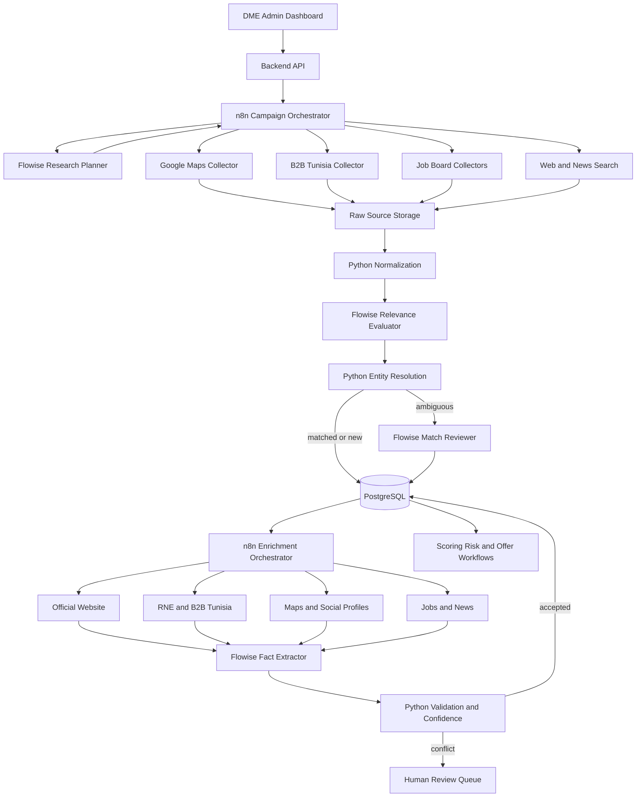

# Company Discovery and Deep Enrichment System

## Purpose

This document specifies the system that discovers previously unknown Tunisian companies, enriches their profiles from multiple sources, validates the collected evidence, and prepares trusted enterprise records for scoring, risk analysis, offer recommendation, and DME prospecting.

The design separates durable workflow automation from AI reasoning:

- **n8n** owns schedules, webhooks, fan-out, batching, retries, rate limits, job state, and calls to external systems.
- **Flowise** owns bounded language-model tasks such as query planning, relevance classification, structured extraction, ambiguity review, and evidence synthesis.
- **Python services** own scraping, deterministic parsing, normalization, entity matching, validation, and data-quality calculations.
- **PostgreSQL** is the system of record for campaigns, candidates, evidence, enterprise profiles, job state, and audit history.
- **A vector store** may index approved product material and enterprise documents, but it is not the authoritative enterprise database.

Flowise and n8n never write arbitrary model-generated fields directly into the canonical enterprise record. All proposed changes pass through validation and provenance checks.

## Scope

### Included in the MVP

- Create a discovery campaign from sector, location, size, and keyword criteria.
- Generate multilingual search queries.
- Collect candidates from configured sources.
- Classify whether a result is a relevant Tunisian enterprise.
- Normalize source records and identify likely duplicates.
- Perform multi-source enrichment for accepted candidates.
- Extract structured facts with evidence.
- Calculate field-level confidence and overall profile completeness.
- Optionally validate and enrich identified companies through the official RNE service.
- Route ambiguous matches and serious conflicts to human review.
- Persist accepted data and full provenance.
- Trigger downstream lead scoring, risk detection, and offer recommendation.

### Excluded from the MVP

- Automatically contacting companies.
- Automatically assigning companies to DME agents.
- Making final legal or compliance decisions.
- Treating inferred or LLM-generated information as verified fact.
- Circumventing authentication, access restrictions, CAPTCHAs, robots policies, or source terms.
- Replacing official RNE information with directory or social-media information.

## Architecture



## Design principles

1. **Evidence before conclusions.** Every stored fact references its source, retrieval time, and extraction method.
2. **Deterministic operations stay deterministic.** Parsing, validation, normalization, matching, retries, and score arithmetic do not depend on an LLM.
3. **One bounded responsibility per AI component.** Query planning, relevance evaluation, fact extraction, match review, and synthesis use separate contracts.
4. **No silent overwrites.** Conflicting values remain visible as evidence until a resolution rule or human decision selects the canonical value.
5. **Idempotent workflows.** Replaying a job does not create duplicate campaigns, candidates, evidence, or enterprises.
6. **Human review for uncertainty.** Low-confidence identity matches, material legal conflicts, and unsupported high-risk findings are not automatically accepted.
7. **Source policy enforcement.** Each collector has an enabled state, rate limit, allowed use, and retention policy.
8. **Structured interfaces.** All Flowise calls use validated JSON input and output rather than free-form text between systems.

## Components

### AI components in Flowise

#### Research Planner

Converts campaign criteria into a bounded multilingual search plan. It does not execute searches.

Responsibilities:

- Produce French, English, and optional Arabic query variants.
- Combine sector synonyms with Tunisian locations and enterprise terms.
- Select only enabled source types.
- Avoid duplicate or excessively broad queries.
- Explain the intent of each query in a short machine-readable field.

#### Candidate Relevance Evaluator

Determines whether a collected result is likely to represent an enterprise eligible for the campaign.

Classification values:

- `ACCEPT`
- `REJECT`
- `REVIEW`

Typical rejection reasons include person, job advertisement without an identifiable employer, foreign organization outside campaign scope, closed business, irrelevant sector, and insufficient identity information.

#### Structured Fact Extractor

Extracts facts from one source document at a time. It must return evidence snippets and must use `null` instead of guessing missing values.

It may extract:

- Names and aliases
- Business description and activities
- Addresses and branches
- Phones, emails, websites, and social profiles
- Employee-size signals
- Founding-year signals
- Executives and roles
- Products, technologies, and digital-maturity signals
- Recent business events

#### Ambiguous Match Reviewer

Reviews candidate pairs only when deterministic entity resolution produces an intermediate score. It cannot override an exact conflicting official identifier.

Decision values:

- `MATCH`
- `NO_MATCH`
- `HUMAN_REVIEW`

#### Evidence Synthesis Agent

Produces a concise business summary after facts have been validated. Its summary is stored as derived content, never as source evidence.

It identifies:

- What the company does
- Main locations and apparent scale
- Growth or digital-maturity signals
- Likely B2B telecom needs
- Important unknowns for a DME agent

### n8n workflows

#### WF01 Campaign Intake

Trigger: backend webhook or approved schedule.

Steps:

1. Validate the campaign request.
2. Create an idempotency key.
3. Validate the official-validation policy without reading or copying the RNE credential.
4. Save the campaign with `DRAFT` or `QUEUED` status.
5. Start `WF02 Discovery Planning`.
6. Return the campaign identifier immediately.

#### WF02 Discovery Planning

1. Load enabled sources and campaign limits.
2. Call the Flowise Research Planner.
3. Validate its JSON response.
4. Enforce the maximum number of queries.
5. Save the approved search plan.
6. Start one `WF03 Source Collection` execution per source and query.

#### WF03 Source Collection

1. Apply source-specific rate limits.
2. Call an API or Python collector.
3. Paginate or batch results.
4. Save raw responses and retrieval metadata.
5. Retry transient failures with bounded exponential backoff.
6. Send records to `WF04 Candidate Intake`.

#### WF04 Candidate Intake

1. Normalize the raw record through the Python service.
2. Run deterministic eligibility checks.
3. Call the Flowise Candidate Relevance Evaluator when semantic review is needed.
4. Reject, accept, or queue the candidate for review.
5. Run entity resolution for accepted candidates.
6. Create a new enterprise candidate or attach the source record to an existing enterprise.

#### WF05 Deep Enrichment

1. Lock one enterprise enrichment job.
2. Load known identifiers and already-fresh evidence.
3. Build a source plan based on missing fields.
4. If official validation is enabled and an RNE-compatible identifier is available, start the RNE validation task.
5. Execute the remaining independent source tasks in parallel.
6. Store every raw response before extraction.
7. Map structured RNE values deterministically and call the Structured Fact Extractor only for unstructured content.
8. Compare RNE identity and legal fields with existing candidate data.
9. Validate facts and calculate confidence.
10. Save accepted evidence and unresolved conflicts.
11. Apply the configured RNE failure and readiness policies.
12. Call the Evidence Synthesis Agent.
13. Update profile completeness, RNE validation status, and enrichment status.
14. Trigger downstream agents if minimum quality gates pass.

#### WF05A RNE Official Validation

This n8n sub-workflow is an official validation and enrichment step, not an AI agent.

Input:

- Enterprise ID
- Official identifier or supported RNE lookup key
- Validation policy
- Correlation and job identifiers

Steps:

1. Confirm that RNE validation is enabled for the campaign.
2. Load the RNE credential from n8n credentials or the configured secret manager.
3. Call the RNE API with a bounded timeout and rate limit.
4. Store the raw response checksum and retrieval metadata in protected storage.
5. Map structured identity, legal status, address, activity, registration, and management fields without an LLM.
6. Compare official fields against the current enterprise candidate.
7. Set the RNE validation status.
8. Create review items for identity or legal-status conflicts.
9. Return a credential-free result to the parent workflow.

The RNE API key or bearer token must never appear in campaign JSON, Flowise state, prompts, agent responses, source URLs stored for ordinary users, or workflow export files.

#### WF06 Refresh and Staleness

Runs on a schedule and selects fields or enterprises whose evidence has expired. Official status and contact information can have different refresh intervals.

#### WF07 Failure and Review Handling

Handles failed jobs, exhausted retries, invalid agent output, source-policy violations, ambiguous matches, and material data conflicts. It creates actionable review items rather than silently discarding records.

### Python services

#### Collector service

Provides source-specific adapters with a common response envelope. It owns HTTP timeouts, pagination helpers, parsing, and raw-response checksums.

#### Normalization service

Normalizes names, domains, phone numbers, locations, dates, employee ranges, and source categories. It removes known placeholder values but preserves the original raw record.

#### Entity resolution service

Uses ordered identity signals:

1. Exact official identifier
2. Exact normalized website domain
3. Exact normalized phone
4. Exact normalized name and compatible location
5. Weighted fuzzy name, address, sector, and contact agreement

Hard conflicts, such as two different official identifiers, prevent automatic merging.

#### Validation and confidence service

Validates formats and calculates confidence using source authority, agreement across sources, recency, extraction certainty, and field-specific rules.

## Core contracts

### Campaign request

```json
{
  "campaign_id": "optional-client-generated-id",
  "requested_by": "user-id",
  "name": "IT companies in Greater Tunis",
  "countries": ["TN"],
  "governorates": ["Tunis", "Ariana", "Ben Arous", "Manouba"],
  "sectors": ["software", "IT services"],
  "keywords": [],
  "employee_range": {
    "minimum": 10,
    "maximum": null
  },
  "maximum_candidates": 200,
  "enabled_source_types": ["maps", "directory", "job_board", "web"],
  "official_validation": {
    "enabled": true,
    "source_id": "rne_kyc",
    "mode": "WHEN_IDENTIFIER_AVAILABLE",
    "failure_policy": "REVIEW",
    "enrich": true
  },
  "language_preferences": ["fr", "en", "ar"]
}
```

Official-validation modes:

- `WHEN_IDENTIFIER_AVAILABLE`: validate automatically when a supported identifier is found; companies without one may continue with a visible unverified status.
- `REQUIRED_BEFORE_READY`: do not mark the enterprise ready for downstream commercial decisions until RNE validation succeeds or a human reviewer grants an exception.
- `MANUAL_ONLY`: create an available validation action but do not call RNE automatically.

Failure policies:

- `CONTINUE_PARTIAL`: keep the enrichment result usable but explicitly unverified.
- `REVIEW`: create a review item when RNE is unavailable, returns no result, or conflicts with the candidate.
- `BLOCK_READINESS`: prevent readiness until validation succeeds or an authorized exception is recorded.

### Research plan output

```json
{
  "plan_version": "1.0",
  "queries": [
    {
      "query_id": "q-001",
      "source_type": "maps",
      "language": "fr",
      "query": "société informatique Tunis",
      "location": "Tunis",
      "sector": "IT services",
      "intent": "Discover IT service companies in Tunis"
    }
  ],
  "stop_conditions": {
    "maximum_queries": 40,
    "maximum_candidates": 200
  }
}
```

### Raw source envelope

```json
{
  "source_record_id": "uuid",
  "campaign_id": "uuid",
  "source_name": "b2b_tn",
  "source_type": "directory",
  "source_url": "https://example.test/company/example",
  "retrieved_at": "2026-09-13T10:00:00Z",
  "http_status": 200,
  "content_type": "application/json",
  "checksum": "sha256-value",
  "payload": {}
}
```

### Candidate relevance output

```json
{
  "decision": "ACCEPT",
  "confidence": 0.94,
  "entity_type": "COMPANY",
  "country": "TN",
  "sector_match": true,
  "reasons": ["Business name and Tunis address are present"],
  "missing_identity_fields": []
}
```

### Extracted fact

```json
{
  "field": "employee_range",
  "value": {
    "minimum": 50,
    "maximum": 99
  },
  "value_text": "De 50 à 99",
  "source_record_id": "uuid",
  "source_url": "https://example.test/company/example",
  "evidence_text": "Nombre d'employés: De 50 à 99",
  "observed_at": "2026-09-13T10:00:00Z",
  "extractor_confidence": 0.98,
  "inferred": false
}
```

### Match review output

```json
{
  "left_record_id": "uuid",
  "right_enterprise_id": "uuid",
  "decision": "MATCH",
  "confidence": 0.91,
  "supporting_signals": ["same domain", "compatible name", "same city"],
  "conflicting_signals": [],
  "requires_human_review": false
}
```

### Enrichment result

```json
{
  "enterprise_id": "uuid",
  "job_id": "uuid",
  "status": "COMPLETED",
  "sources_attempted": 7,
  "sources_succeeded": 5,
  "facts_proposed": 34,
  "facts_accepted": 27,
  "conflicts_created": 2,
  "profile_completeness": 0.78,
  "quality_score": 0.84,
  "official_validation": {
    "provider": "RNE",
    "status": "VERIFIED",
    "validated_at": "2026-09-13T10:15:00Z",
    "conflicts": []
  },
  "ready_for_scoring": true,
  "ready_for_offer_recommendation": true,
  "review_item_ids": []
}
```

## Status models

### Campaign status

```text
DRAFT → QUEUED → PLANNING → COLLECTING → PROCESSING → COMPLETED
                                      ↘ PARTIAL
                                      ↘ FAILED
                                      ↘ CANCELLED
```

### Candidate status

```text
DISCOVERED → NORMALIZED → ACCEPTED → MATCHED_OR_CREATED → ENRICHING → READY
                         ↘ REJECTED
                         ↘ REVIEW_REQUIRED
```

### Enrichment job status

```text
QUEUED → RUNNING → VALIDATING → COMPLETED
                    ↘ REVIEW_REQUIRED
          ↘ RETRY_WAIT → RUNNING
          ↘ PARTIAL
          ↘ FAILED
```

### RNE validation status

```text
NOT_REQUESTED → PENDING → VERIFIED
                     ↘ NOT_FOUND
                     ↘ CONFLICT
                     ↘ UNAVAILABLE
SKIPPED_NO_IDENTIFIER
```

`NOT_FOUND` does not prove that a company is illegitimate. It means only that the attempted lookup returned no matching record. `CONFLICT` always requires review when the conflict concerns identity or legal status.

## Quality and precedence rules

Field precedence is field-specific rather than source-wide:

- Official identifiers and legal status: RNE or another authorized official registry.
- Company-controlled facts: official company website, subject to validation.
- Address and location: official registry for legal address; Maps for operating-location evidence.
- Employee size: recent company disclosure or trusted directory, otherwise retain as an estimate.
- Executives: official registry or company-controlled page preferred over third-party directories.
- Ratings and reviews: Maps or the original review platform only.
- Business descriptions: preserve source descriptions and generate a separate synthesized description.

A lower-priority source does not overwrite a higher-priority value. It can create corroborating or conflicting evidence.

When RNE validation succeeds, official identity and legal fields receive the highest source authority. RNE data may enrich the profile, but it does not erase the discovery evidence or operating-location information from other sources. Commercial descriptions, digital signals, reviews, employee estimates, and recent events still come from their appropriate sources.

## Human review triggers

- Conflicting official identifiers
- Probable match score inside the configured ambiguity band
- Legal status conflict
- High-risk allegation supported only by unverified text
- Company country cannot be determined
- Executive contact information has uncertain provenance
- AI output fails schema validation after one repair attempt
- A source appears to return placeholder or systematically corrupted values

## Safety and access controls

- Keep API credentials and credential-like URL segments in the secret store, never in Flowise exports, workflow JSON, logs, or Git.
- Store only the name of the RNE credential configuration in deployment settings; never store the secret value in campaign or enterprise records.
- Apply per-source rate limits and an explicit enabled/disabled configuration.
- Store only the evidence required for the project and define retention periods.
- Restrict personal contact data to authorized roles.
- Sanitize HTML before presenting source content in the dashboard.
- Treat all external text as untrusted data.
- Require human confirmation before any future workflow contacts a company or changes a prospecting assignment.
- Log model, prompt version, workflow version, tool calls, source record identifiers, and validation outcome for every AI decision.

## Observability

Every execution must expose:

- Correlation ID, campaign ID, enterprise ID, and job ID
- Workflow name and version
- Start time, end time, duration, and status
- Source requests, response status, retry count, and rate-limit events
- Flowise agent name, model, prompt version, token usage when available, and schema-validation result
- Record counts at every stage
- Accepted, rejected, merged, and review-required counts
- Error category without leaking credentials or full sensitive payloads

Minimum operational metrics:

- Candidate acceptance rate
- Duplicate rate
- Automatic-match and human-review rates
- Enrichment success rate by source
- Average enrichment duration
- Profile completeness distribution
- Invalid AI output rate
- Cost or compute time per accepted enterprise

## Flowise implementation standard

Use Agentflow V2 or an equivalent explicit flow for every new agent. Each flow should contain:

1. Start node with named JSON inputs
2. Input-schema validation
3. Prompt with narrow responsibility
4. Model call with temperature near zero for classification and extraction
5. Structured-output schema
6. Validation and one bounded repair attempt
7. Failure branch returning a typed error
8. Prompt and contract version in the response metadata

Do not give a model access to general-purpose tools when a deterministic Tool node or n8n step already knows which operation must run.

## n8n implementation standard

- One parent workflow and reusable source sub-workflows
- Webhook responses return job identifiers instead of waiting for full discovery
- Bounded concurrency and batch sizes
- Idempotency keys for all create and update operations
- Retry only transient failures
- Dead-letter path for exhausted retries
- Credentials stored in n8n credentials or an external secret manager
- No long enterprise payloads embedded in workflow configuration
- Explicit timeout for every external call
- Persist job transitions before starting the next expensive stage

## MVP acceptance criteria

The discovery and enrichment system is ready for pilot use when:

1. A DME admin can submit a campaign and immediately receive a campaign ID.
2. A campaign can collect candidates from at least three configured source types.
3. Replaying the same collection payload creates no duplicate source records.
4. Obvious persons, foreign results, and irrelevant pages are rejected with a reason.
5. Exact domain and phone matches attach to the same enterprise.
6. Ambiguous identity matches create review items rather than automatic merges.
7. Every accepted field can be traced to at least one evidence record.
8. Missing values remain null and are not invented by an LLM.
9. One source failure can produce a partial enrichment result without losing successful evidence.
10. Invalid Flowise JSON is repaired once or returned as a typed failure.
11. A completed enterprise exposes completeness, quality, scoring readiness, and offer-readiness indicators.
12. Secrets do not appear in exported Flowise or n8n workflow files or application logs.
13. When RNE validation is enabled, the configured mode and failure policy control readiness exactly as specified.
14. RNE responses enrich official fields without overwriting unrelated evidence or hiding conflicts.

## Test scenarios

### T01 New company

A Maps result has a unique domain and no database match. The system creates a candidate, enriches it, and produces a new enterprise record with evidence.

### T02 Exact duplicate

The same company arrives from a job board with an identical normalized domain. The source is attached to the existing enterprise without creating a duplicate.

### T03 Ambiguous short name

A candidate named `3S` has no domain and only a Tunis location. The system creates a review item instead of merging it with a similarly named company.

### T04 Conflicting official identity

Two records share a phone but have different official identifiers. The system blocks the merge and requests human review.

### T05 Placeholder values

Many records contain the same directory website and social links. The normalization service marks those values as source placeholders and excludes them from canonical fields.

### T06 Partial source failure

The news source times out while the website and directory collectors succeed. The enrichment completes as `PARTIAL`, retains successful evidence, and schedules only the failed source for retry.

### T07 Unsupported claim

An extractor claims an employee count without evidence text. Validation rejects the fact.

### T08 Stale profile

A company has an old directory record but a recent official website. The system keeps both evidence records and selects canonical fields using recency and field-specific authority.

### T09 RNE validation succeeds

An accepted candidate has a supported official identifier. n8n calls RNE, stores credential-free retrieval metadata, maps the structured response, sets status to `VERIFIED`, and preserves the original discovery evidence.

### T10 No RNE identifier

RNE validation uses `WHEN_IDENTIFIER_AVAILABLE`, but the candidate has no supported identifier. The system sets `SKIPPED_NO_IDENTIFIER`, keeps the profile explicitly unverified, and continues according to the campaign policy.

### T11 RNE identity conflict

RNE returns an official name or identifier that conflicts materially with the candidate. The system does not silently overwrite or merge the identity. It sets `CONFLICT` and creates a human-review item.

### T12 RNE unavailable

The RNE request fails after bounded retries. The system applies `CONTINUE_PARTIAL`, `REVIEW`, or `BLOCK_READINESS` exactly as configured and does not lose evidence collected from other sources.

## Implementation sequence

1. Freeze the JSON contracts and enumerations.
2. Build the Flowise Research Planner with mock campaign inputs.
3. Build the Candidate Relevance Evaluator.
4. Build the Structured Fact Extractor.
5. Build n8n campaign intake and planning workflows.
6. Add one source collector end to end.
7. Add normalization, evidence storage, and idempotency.
8. Add deterministic entity resolution and the ambiguous-match reviewer.
9. Add deep-enrichment fan-out and validation.
10. Add review handling, observability, and downstream triggers.

The first implemented agent should be the **Research Planner**, because it establishes the contract between the dashboard, n8n, Flowise, and every discovery source without depending on the final enterprise dataset.
